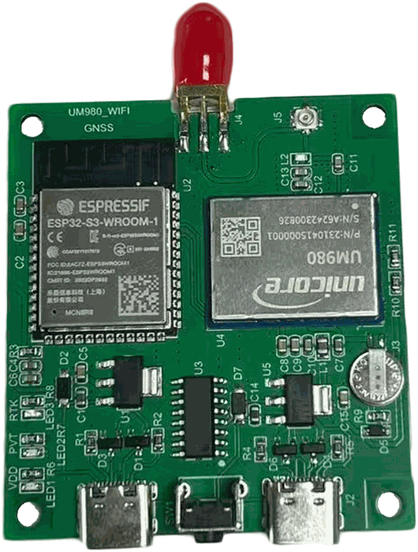
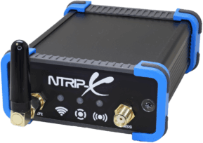
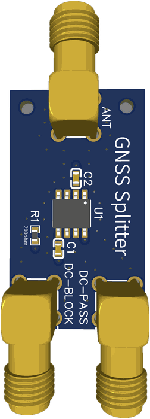

# onodiy: DIY $150 Onocoy NTRIP server

Open-source firmware that turns a Unicore + ESP32-S3 board into a plug-and-play
**Onocoy** reference station: plug in an antenna, join your Wi-Fi, enter your Onocoy
credentials.

- **All-band, set up for you:** 4-band signals with Galileo E6, survey-in, and the RTCM
  messages Onocoy asks for.
- **Streams everywhere at once:** Onocoy, up to 3 more NTRIP servers, and your own rover
  on your home network.
- **Web UI:** setup, live status and sky map, 24h connection and device stats, logs.
- **Hands-off:** recovers on its own; one-click updates from GitHub Releases.

MIT-licensed. An independent project, not affiliated with Onocoy.

## Hardware

<table width="100%">
<tr>
<td align="center" width="14%"></td>
<td align="center" width="26%"></td>
<td align="center" width="48%"></td>
<td align="center" width="12%"></td>
</tr>
<tr>
<td align="center"><b>UM982</b></td>
<td align="center"><b>UM980</b> (configured, untested)</td>
<td align="center"><b>NTRIP-X</b> (untested)</td>
<td align="center"><b>GNSS splitter</b> (optional)</td>
</tr>
</table>

| Board | ESP32-S3 module | Price | Buy |
|---|---|---|---|
| **UM982** + ESP32-S3 | WROOM-1 N16R8 (built-in antenna), or WROOM-1U (external antenna: the "Um982 Wifi Ipex" option) | about US$140 | [AliExpress](https://www.aliexpress.com/item/1005013018359434.html), [Alt](https://www.aliexpress.com/item/1005013190792289.html) |
| **UM980** + ESP32-S3 | WROOM-1 N16R8 (built-in antenna); ask the seller for WROOM-1U-N16R8 (external antenna), same price | US$150 | [Alibaba](https://www.alibaba.com/product-detail/Custom-UM980-GNSS-ESP32-S3-WiFi_1601897914814.html) |
| **NTRIP-X** (UM980, by GNS Electronics) | WROOM-1U-N8R8 (external Wi-Fi antenna), in a case with LEDs and a button | about US$299 | [GNS Electronics](https://www.gns-electronics.de/product/ntrip-x/) |
| **Antenna:** Beitian BT-800S | N/A (all the bands the station uses; TNC socket, so a TNC-to-SMA cable) | about US$53 | [AliExpress](https://www.aliexpress.com/item/1005009033251316.html) (variant "BT-800S") |
| **Antenna cable:** RG58, TNC male to SMA male | N/A (antenna to board; pick the length) | from about US$5, by length | [AliExpress](https://www.aliexpress.com/item/1005005550779000.html) |
| **GNSS splitter** (optional) | N/A (shares one antenna between two receivers) | about US$11 assembled (JLCPCB) | [View more](gnss-splitter/README.md) |
| **Splitter jumpers:** SMA male to SMA male (RG402) | N/A (splitter to each receiver) | from about US$4, by length | [AliExpress](https://www.aliexpress.com/item/1005002380816726.html) |

- **Antenna:** a multi-band GNSS antenna on the SMA socket (`M` on the UM982 board).
  Plug or unplug it only with the power off: the socket powers the antenna.
- **Power:** a 5 V USB-A charger and an A-to-C cable into the USB-C printed `ESP32S3`
  (a USB-C charger gives the UM982 board no power). The NTRIP-X: a USB-C supply of 2 A or more.
- **Weak Wi-Fi?** Choose the external-antenna module. The Status page shows the signal
  and the ping time to your router over 24h.

More: [hardware details](docs/hardware.md), [board notes](reference/um982-board-onocoy.md),
[antenna notes](reference/antenna-specs.md).

## Supported boards

One firmware for every board; only the install differs.

| Board | Flash | Install image | Status |
|---|---|---|---|
| UM982 board (AliExpress) | 16 MB | `onodiy-install-16mb.bin` | tested |
| UM980 board (Alibaba) | 16 MB | `onodiy-install-16mb.bin` | configured, untested |
| NTRIP-X | 8 MB | `onodiy-install-um980-ntrx.bin` | untested; LEDs and button follow GNS's quick guide; no receiver updates yet |

Another ESP32-S3 board with a Unicore receiver and 16 MB flash: the 16 MB image, then set its
pins under Settings → Receiver wiring. The NTRIP-X image is for the NTRIP-X only (it drives the
NTRIP-X's LED pins); boards with 8 MB flash are not supported otherwise. The NTRIP-X's own
firmware is in [`firmware/ntrip-x/`](firmware/ntrip-x/README.md), to go back to it.

## Install

Download your board's image from the
[latest release](https://github.com/Averyy/onodiy-esp32-ntrip-server/releases/latest),
then erase the board and write the image at 0x0:

```sh
esptool --chip esp32s3 erase-flash
esptool --chip esp32s3 write-flash 0x0 onodiy-install-16mb.bin
```

On the NTRIP-X, save its flash first (`esptool --chip esp32s3 read-flash 0 0x800000
ntrip-x-backup.bin`). After that, updates install from the web UI. Changes:
[CHANGELOG](CHANGELOG.md).

## First setup

1. Power the station and join its hotspot, `onodiy-XXXX`, with a phone (or open
   `http://192.168.4.1/`).
2. Choose the admin password and your Wi-Fi network.
3. Back on your Wi-Fi, open **`http://onodiy.local/`** and **Login**. Setup continues
   with an antenna check and Onocoy.

**Onocoy:** in the Onocoy console add an NTRIP credential (Reference Stations, NTRIP
Credentials) and enter its username and password. The station connects to
`servers.onocoy.com:2101` and sends every message
[Onocoy's guide](https://docs.onocoy.com/documentation/3.-become-a-miner/3.-connect-your-station-to-onocoy)
lists, every second. Add, edit or delete servers on the NTRIP page.

## Local server (NTRIP for your rover)

Corrections straight to your own rover on your home network, no internet in between. On
the **NTRIP** page turn on **Local server** and choose a password, then set the rover's
NTRIP client to:

| Setting | Value |
|---|---|
| Host | `onodiy.local`, or the station's IP address |
| Port | `2101` |
| Mountpoint | the one on the card (default `onodiy`) |
| Username / password | the ones on the card (default username `rover`) |
| NTRIP version | 2.0 (1.0 if the rover shows garbled data) |

Up to 4 rovers, local network only.

## Updates

The station checks GitHub Releases daily and shows a banner; nothing installs until you
click Update. Files are checked against the release's SHA-256 manifest, and a new
version runs on trial, going back to the previous one if it fails.
[More](docs/releases.md).

## Building

Requires ESP-IDF v6.1:

```sh
. $IDF_PATH/export.sh
idf.py set-target esp32s3 && idf.py build
idf.py -p <port> flash monitor   # the USB-C printed "ESP32S3"
```

Tests, no hardware needed:

```sh
cd test/host && idf.py --preview set-target linux && idf.py build && ./build/onodiy_host_tests.elf
cd tools/bench && uv run --locked pytest
```

The firmware also runs in QEMU (`tools/qemu/run.sh`, web UI at `http://localhost:8080/`).
More: [development](docs/development.md).

## Repository layout

| Path | Contents |
|---|---|
| `main/`, `components/` | The firmware |
| `test/` | Host unit tests and recorded data |
| `tools/bench/`, `tools/qemu/`, `tools/ci/` | Board tools, the emulator, CI run locally |
| `firmware/um982/`, `firmware/um980/` | Unicore receiver firmware |
| `firmware/ntrip-x/` | The NTRIP-X's stock firmware, for restoring one |
| `gnss-splitter/` | The antenna splitter (EasyEDA) |
| `docs/`, `reference/` | Hardware, development, releases; board and antenna notes |

## License

[MIT](LICENSE) for this project's code. The firmware image also contains ESP-IDF,
FreeRTOS, lwIP, Mbed TLS, cJSON and others under their own licenses
([`THIRD_PARTY_NOTICES.md`](THIRD_PARTY_NOTICES.md)). The receiver firmware in
`firmware/um982/` and `firmware/um980/` is Unicore's, redistributed for convenience and not covered by
this license; `firmware/ntrip-x/` is GNS-Electronics' GPLv3 firmware ([its notes](firmware/ntrip-x/README.md)).
