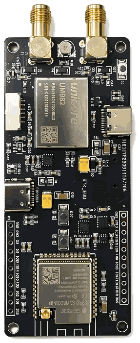
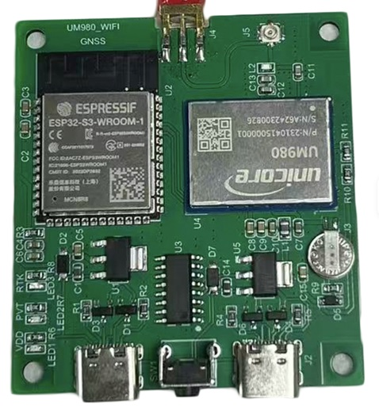
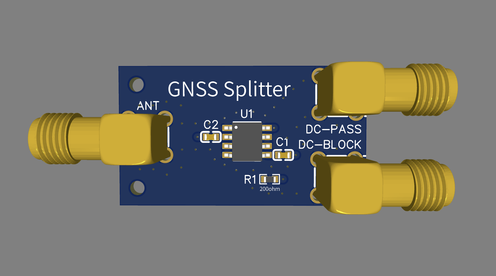

# onodiy (onodiy-esp32-ntrip-server)

Open-source ESP-IDF firmware that turns the **Unicore UM982 + ESP32-S3** dev board
(about C$200) into a plug-and-play RTK base station for **Onocoy** and other NTRIP
servers.

- Sets up the receiver by itself: the 4-band signal group, a survey-in, and the RTCM
  messages Onocoy asks for.
- Streams to Onocoy and up to 3 more NTRIP servers at once, and to your own rover on
  your home network.
- A web UI for setup, status, a live sky map, logs and updates. The Status page also
  shows ping times to your router and to Onocoy, the Wi-Fi signal, CPU and memory, over
  the last 24h.
- Watches its own health and recovers by itself.
- Updates from GitHub Releases, installed only when you click Update.

All code is original and MIT-licensed. onodiy is an independent project, not
affiliated with or endorsed by Onocoy.

> **Early development.** Working on the board with an antenna: the receiver setup, the
> survey-in and lock, corrections every second with Galileo E6, streaming to a test
> NTRIP server and to local clients, and updates by file upload and from GitHub
> Releases. **Not tested yet:** streaming to Onocoy live, and a real rover. Don't use it
> for a station you rely on yet.

## Hardware

<table>
<tr>
<td width="60%"></td>
<td width="40%"></td>
</tr>
<tr>
<td><em>The UM982 board, here with the external Wi-Fi antenna connector: Unicore UM982 receiver (left of centre), ESP32-S3 module (right), USB-C to the receiver's COM2 (top edge), USB-C printed <code>ESP32S3</code> for the ESP32-S3 (bottom edge), and the SMA antenna sockets <code>M</code> (lower) and <code>S</code> (upper) on the left.</em></td>
<td><em>The UM980 board: ESP32-S3-WROOM-1 module (left), Unicore UM980 receiver (right), the GNSS antenna's SMA socket (top edge), two USB-C ports (bottom edge). Not supported yet (below).</em></td>
</tr>
</table>

- **The board:** ESP32-S3-WROOM-1 N16R8 (16 MB flash, 8 MB PSRAM) and a Unicore UM982
  all-band receiver. The ESP32 talks to the receiver's COM1.
- **Weak Wi-Fi where the antenna goes?** The same board is also sold with an external
  Wi-Fi antenna (the ESP32-S3-WROOM-1U module and its antenna connector): the "Um982 Wifi
  Ipex" option of [this listing](https://www.aliexpress.com/item/1005013018359434.html).
  An external antenna reaches much farther than the module's built-in one. The Status
  page's Performance card shows the signal and the ping time to your router over 24h.
- **UM980 version (not supported yet):** the same idea with a Unicore UM980 receiver,
  whose firmware updates are easier to find: [this listing](https://www.alibaba.com/product-detail/Custom-UM980-GNSS-ESP32-S3-WiFi_1601897914814.html),
  US$150 (about C$212). It comes with the built-in Wi-Fi antenna; message the seller to
  get the ESP32-S3-WROOM-1U-N16R8 (external antenna) instead, at the same price. The
  firmware recognises a UM980 but does not configure it yet: UM980 support is planned.
- **Antenna:** a multi-band GNSS antenna on the lower SMA socket, marked `M`. Connect
  or disconnect it only with the power off: the socket carries the antenna's power.
- **Power:** a plain 5 V USB-A charger and an A-to-C cable into the USB-C printed
  `ESP32S3`. A C-to-C cable or a USB-C charger gives no power: the board lacks the
  USB-C CC resistors.

More: [hardware details](docs/hardware.md) (the two USB-C ports, the console, the
board as delivered), [board notes](reference/um982-board-onocoy.md),
[antenna and cable notes](reference/antenna-specs.md) and an optional
[antenna splitter](gnss-splitter/README.md).

## Install

Download the files from the
[latest release](https://github.com/Averyy/onodiy-esp32-ntrip-server/releases/latest):
its notes give the `esptool` command for a new board. After that, updates install from
the web UI. Or [build it yourself](#building). What each release changes:
[CHANGELOG](CHANGELOG.md).

## First setup

1. Power the station. It opens a setup hotspot, `onodiy-XXXX`. Join it with a phone:
   the setup page opens by itself (or open `http://192.168.4.1/`).
2. Choose the admin password, then your Wi-Fi network.
3. Put the phone back on your Wi-Fi, open **`http://onodiy.local/`** (or the address
   the page showed) and **Login**. The setup continues with an antenna check and
   Onocoy.

**Onocoy.** In the Onocoy console, add an NTRIP credential (Reference Stations, NTRIP
Credentials). Enter its username and password, and any mountpoint name. The station
connects to `servers.onocoy.com:2101` with NTRIP 2.0 and sends the messages
[Onocoy's guide](https://docs.onocoy.com/documentation/3.-become-a-miner/3.-connect-your-station-to-onocoy)
lists, every second: 1005, 1033, MSM7 1077, 1087, 1097, 1117, 1127, 1137 and 1230.
Add, edit or delete servers on the NTRIP page.

The station answers at `http://onodiy.local/` (`onodiy-2.local` if another device has
the name) and at its IP address. Settings shows both.

## Local server (NTRIP for your rover)

> [!WARNING]
> **Not yet tried with a real rover app.** Tested with standard NTRIP clients, in the
> emulator and on the board. If you try it with a rover, please open an issue.

The station can send corrections straight to your own rover on your home network, with
no internet in between. On the **NTRIP** page, turn on **Local server** and choose a
password. Then set the rover's NTRIP client to:

| Setting | Value |
|---|---|
| Host | `onodiy.local`, or the station's IP address (use the IP if the rover can't find `.local` names) |
| Port | `2101` |
| Mountpoint | the one on the card (default: the station's name, `onodiy`) |
| Username / password | the ones on the card (default username `rover`) |
| NTRIP version | 2.0, or 1.0 if the rover shows garbled data |

At most 2 rovers at once, and only from your local network: the station refuses other
addresses, so a port forward doesn't expose it (don't forward port 2101 anyway). It's
for your own rover only: Onocoy's terms allow its loopback stream for internal use
only.

## GNSS splitter



An optional board that shares one antenna between two receivers, such as this station
and another one, for about C$15 assembled at JLCPCB. The receiver on **DC-PASS** powers
the antenna; the one on **DC-BLOCK** gets only the signal. To feed a third receiver,
connect a second splitter to the first one's DC-BLOCK port, so DC-PASS still powers
the antenna. Design files, parts and notes: [gnss-splitter/](gnss-splitter/README.md).

## Updates

The station checks GitHub Releases once a day and shows a banner; nothing is
downloaded or installed until you click Update. It downloads only from this
repository's releases over checked HTTPS, and uses a file only if its size and SHA-256
match the release's manifest. A new version runs on trial and goes back to the
previous one if it fails. Settings also installs a file you choose (Install manually).

Receiver firmware updates (UM982 `.pkg` files, over the board's serial link) are built
but stay off until tested on a bench unit. How releases are cut and what a station
trusts: [releases and updates](docs/releases.md).

## Recovery

Not yet confirmed on the board.

- **Forgot the admin password:** hold **BOOT** (printed `BOT`, next to the `ESP32S3`
  USB-C) for 10 s. The password is cleared and the setup hotspot opens for 15 minutes
  to set a new one. Everything else is kept.
- **Wi-Fi gone:** the station keeps retrying, and after 5 minutes offline it also
  opens the setup hotspot so you can fix the Wi-Fi.
- **Factory reset:** hold **BOOT** for 20 s. Every setting is erased and the station
  restarts in setup mode.
- **Safe mode:** after repeated crashes the station keeps Wi-Fi, the web UI and
  updates running but stops the receiver and the streams. It tries a normal start
  again after 1 h, 4 h, then every 24 h, or at once from the web UI.

## Building

Requires ESP-IDF v6.1. From the repository root:

```sh
. $IDF_PATH/export.sh            # your ESP-IDF v6.1 checkout
idf.py set-target esp32s3
idf.py build
idf.py -p <port> flash monitor   # the USB-C printed "ESP32S3"
```

Tests, no hardware needed:

```sh
cd test/host && idf.py --preview set-target linux && idf.py build && ./build/onodiy_host_tests.elf
cd tools/bench && uv run --locked pytest
```

The firmware also runs in Espressif's QEMU, with the web UI at `http://localhost:8080/`
(`tools/qemu/run.sh`). CI's jobs run locally, bench builds and the emulator:
[development](docs/development.md).

## Repository layout

| Path | Contents |
|---|---|
| `main/`, `components/` | The firmware (one component per subsystem) |
| `test/host/`, `test/fixtures/` | Host unit tests and the recorded data they use |
| `tools/bench/` | Tools for working on a board: ports, captures, receiver queries, RTCM inspection, NTRIP test clients and casters ([README](tools/bench/README.md)) |
| `tools/qemu/`, `tools/ci/` | The emulator setup and CI's jobs run locally ([README](tools/qemu/README.md)) |
| `firmware/um982/` | Unicore UM982 receiver firmware ([README](firmware/um982/README.md)) |
| `gnss-splitter/` | An optional GNSS antenna splitter (EasyEDA) |
| `docs/` | Hardware details, development, releases and updates |
| `reference/` | Board and antenna notes |

## License

Our code is under the [MIT License](LICENSE). The firmware image also contains
ESP-IDF, FreeRTOS, lwIP, Mbed TLS, cJSON and other components under their own licenses;
see [`THIRD_PARTY_NOTICES.md`](THIRD_PARTY_NOTICES.md), which ships with every build.
The receiver firmware packages in `firmware/um982/` and `firmware/um980/` are Unicore's,
redistributed for convenience, and **not** covered by this project's license.
