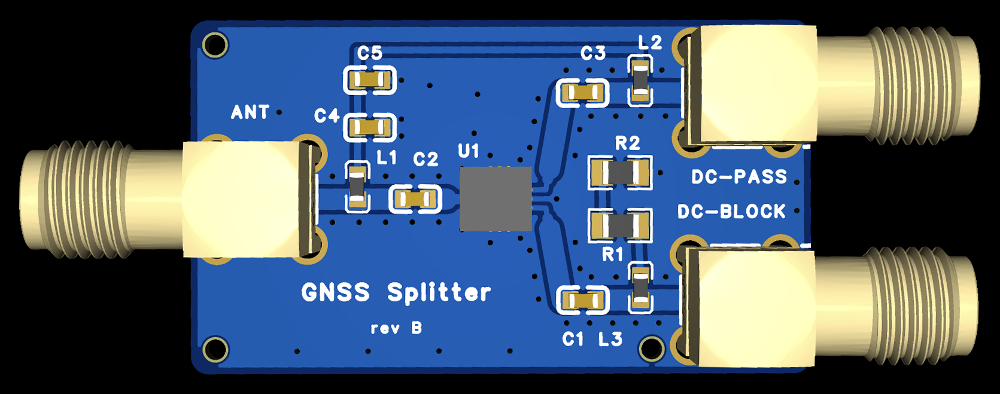

# GNSS Antenna Splitter — rev B



Passive 1-to-2 GNSS antenna splitter PCB for sharing one active antenna between two receivers. The DC-PASS receiver powers the antenna; the DC-BLOCK receiver gets RF without backfeeding the antenna supply. Designed in EasyEDA Pro, released and ordered 2026-11-01. Rev B replaces the original board; only rev B files are included here.

The first order of five assembled boards cost US$58.01 delivered to Canada, about **US$11.60 per board**. Boards have not arrived; electrical performance below is computed, not measured. Pair with short [SMA patch cables](https://www.aliexpress.com/item/1005002380816726.html).

**Important:** This is a bare PCB with exposed SMA connectors. Wrap it in a non-conductive case or electrical tape to prevent shorts and reduce interference. Don't let it rest on metal surfaces.

## How it works

An active GNSS antenna has a built-in LNA powered by DC bias from a receiver through the coax (typically 3.3–5 V). The board separates that DC supply from the RF splitter:

- **ANT:** antenna input.
- **DC-PASS:** primary receiver output. Its bias reaches ANT through L2 → BIAS → L1, around the splitter. C4 (47 pF) and C5 (100 nF) bypass the bias line to ground.
- **DC-BLOCK:** secondary receiver output. C1 blocks DC towards the splitter; L3 connects the receiver to a 200 Ω DC load (R1 + R2), keeping the resistors off the RF path.

All three GP2S+ ports are DC-blocked: C2 on SUM, C3 on DC-PASS and C1 on DC-BLOCK. The board needs no separate power supply and provides no RF amplification.

The original PCB's series input capacitor blocked its intended antenna bias path, and its RF routing was not 50 Ω. Rev B adds the separate bias path, nominal 50 Ω top-layer routing and a choke ahead of the DC-BLOCK load.

## Schematic

```text
          ┌────────┬────────┬──── BIAS ──────────────┐
          │        C4       C5                       │
          │        │        │                        │
          │       GND      GND                       │
          L1                                         L2
          │                                          │
   ANT ●──┴──[C2]──┤ GP2S+ ├──[C3]───────────────────┴──● DC-PASS
                       │
                       └──[C1]──┬───────────────────────● DC-BLOCK
                                L3
                                │
                          R1 + R2 (200 Ω)
                                │
                               GND
```

See the [exported schematic](Schematic_GNSS-Splitter_revB.png) for pin-level connections.

## BOM

14 placements, six BOM lines. Parts were in JLCPCB stock at release; availability can change.

| Ref | Part | Package | Qty | LCSC # | Notes |
|---|---|---|---|---|---|
| U1 | Mini-Circuits GP2S+ | QFN-12, 3 × 3 mm (DQ1225) | 1 | C3155018 | Passive 2-way splitter, 800–2100 MHz |
| ANT, DC-PASS, DC-BLOCK | BAT Wireless BWSMA-KWE-Z001 | SMA female TH | 3 | C496551 | |
| C1, C3, C4 | Samsung CL10C470JB8NNNC, 47 pF C0G | 0603 | 3 | C1671 | Output DC blocks; bias-line RF bypass |
| C2, C5 | Yageo CC0603KRX7R9BB104, 100 nF X7R | 0603 | 2 | C14663 | SUM DC block; bias-line decoupling |
| L1, L2, L3 | Murata LQW18AN68NG00D, 68 nH | 0603 | 3 | C86135 | Bias chokes; DC-load choke |
| R1, R2 | UNI-ROYAL 0805W8F1000T5E, 100 Ω 1% | 0805 | 2 | C17408 | Series 200 Ω load; 62.5 mW each at 5 V |

The [GP2S+ datasheet](https://www.minicircuits.com/pdfs/GP2S+.pdf) specifies 800–2100 MHz, including GPS L5 / Galileo E5a / BeiDou B2a at 1176.45 MHz (the original BP2G1+ starts at 1200 MHz). Typical datasheet isolation is 22.7 dB at 1170 MHz and 21.1 dB at 1550 MHz. GP2S+ is end-of-life; GP2SA+ is its drop-in successor, but is not the part in this release's BOM.

## Board and computed RF performance

35 × 20 mm, two layers, 1.6 mm FR-4, 1 oz copper, 1 mm rounded corners. SMA positions match the original. There are no mounting holes; three Ø1.152 mm tooling holes support assembly. Silkscreen reads “GNSS Splitter” and “rev B”. The supplied image is a 3D render; the order preview specified purple solder mask.

RF traces are top-layer grounded coplanar waveguide: 1.2 mm wide with 0.254 mm clearance to ground, stepping to 0.6 / 0.3 mm at U1. Computed impedance is 50.1 Ω nominal (about 46–54 Ω for ±0.05 mm etch per edge). Two-layer fabrication is not impedance-controlled.

These are **computed segment losses**, excluding the splitter itself, SMA launch and QFN pad parasitics, and solder mask. Return loss is the worst computed value across the sampled GNSS bands (1176–1602 MHz), not a whole-board measurement.

| Segment | Loss at 1176 MHz | Loss at 1575 MHz | Worst return loss |
|---|---|---|---|
| ANT → splitter SUM | 0.11 dB | 0.14 dB | 17.5 dB |
| Splitter → DC-PASS | 0.11 dB | 0.14 dB | 18.5 dB |
| Splitter → DC-BLOCK | 0.26 dB | 0.24 dB | 18.0 dB |

Add the input and output segment losses to the GP2S+'s typical total loss of about 3.7–3.9 dB to estimate a complete path: roughly 3.9–4.3 dB at these two frequencies. This is an estimate, not a measured specification. See the [computed RF output](computed-rf-revB.txt) for all sampled bands. Real choke impedance and physical RF performance remain to be checked.

## Fabrication and ordering

Upload the [Gerber ZIP](Gerber_GNSS-Splitter_revB.zip), [BOM](BOM_GNSS-Splitter_revB.csv) and [CPL](CPL_GNSS-Splitter_revB.csv) to JLCPCB Economic PCBA. The BOM is JLC-ready UTF-16, tab-separated; keep that encoding. All parts are on top.

- Choose tooling holes **Added by Customer**.
- In part matching, tick the SMA row (ANT / DC-BLOCK / DC-PASS, C496551). Mixed designator prefixes can leave it unticked at quantity zero.
- Check the manufacturer's part matching and placement preview before ordering.
- Customs description used: “printed circuit board assembly, passive GNSS antenna signal splitter”, category “Other”.

The 2026-11-01 order was PCB US$1.95 + Economic PCBA US$44.99 + shipping US$2.62 + prepaid duties/taxes US$8.45 = **US$58.01 for five**, approximately US$11.60 each delivered to Canada. This is a historical order cost, not a current quote.

Release software checks reported ERC/DRC zero errors, schematic/PCB netlist agreement, BOM/CPL 14/14 placements, and IPC netlist agreement (48 pins, 10 nets). Export, outline, drill, mask and clearance checks passed. These checks do not establish measured RF performance or assembly quality. [SHA256SUMS](SHA256SUMS) identifies the copied release files and routing previews.

## Use case

Share one multi-band GNSS antenna between:

- A GEODNET miner (DC-PASS port, it supplies the antenna bias voltage).
- An Onocoy station (DC-BLOCK port, gets RF only, no DC conflict).

Or any two compatible GNSS receivers that need to share an antenna without both trying to power it.

GEODNET advises against splitters because they can cause interference, and onocoy flags two of its stations that share one antenna (see [`reference/antenna-specs.md`](../reference/antenna-specs.md)).

## Daisy-chaining

To feed more than two receivers, connect the second splitter's ANT input to the first splitter's DC-BLOCK port. Keep the first splitter's DC-PASS port for a receiver supplying antenna bias; without it the antenna gets no power. Each additional split adds RF loss. A receiver on the second splitter's DC-PASS also sees the first board's 200 Ω load through its bias path; include that current in the receiver's supply budget and keep its bias at ≤ 5 V.

## Notes and limits

- DC-PASS must be connected to a receiver supplying antenna bias. DC-BLOCK alone cannot power the antenna's LNA.
- DC-BLOCK is isolated from ANT and DC-PASS at DC, but has a 200 Ω load to ground through L3. At 5 V it draws about 25 mA. **Bias on DC-BLOCK must be ≤ 5 V**; 12 V would overheat R1/R2.
- L1–L3 are rated 340 mA. Check the receiver's antenna-supply voltage, current budget and current limit. L1 + L2 have at most 0.76 Ω DC resistance (about 36 mV drop at 48 mA, computed).
- No ESD or surge protection is fitted to the SMA ports. Connect cables with devices powered off.
- Boards have not arrived; insertion loss, return loss, isolation, antenna power delivery and physical fit are not yet bench-tested.

## Files

| File | Description |
|---|---|
| [GNSS-Splitter_revB.epro2](GNSS-Splitter_revB.epro2) | Editable EasyEDA Pro release project: File → Import |
| [Gerber_GNSS-Splitter_revB.zip](Gerber_GNSS-Splitter_revB.zip) | Fabrication Gerbers and drills |
| [BOM_GNSS-Splitter_revB.csv](BOM_GNSS-Splitter_revB.csv) | JLC assembly BOM (UTF-16, tab-separated) |
| [CPL_GNSS-Splitter_revB.csv](CPL_GNSS-Splitter_revB.csv) | Pick and place, millimetres, all top |
| [Schematic_GNSS-Splitter_revB.png](Schematic_GNSS-Splitter_revB.png) | Schematic; no schematic PDF in this release |
| [PCB_GNSS-Splitter_revB.pdf](PCB_GNSS-Splitter_revB.pdf) | PCB drawing |
| [GNSS-Splitter_revB.step](GNSS-Splitter_revB.step) | 3D model |
| [GNSS-Splitter_revB.ipc](GNSS-Splitter_revB.ipc) | IPC-D-356A netlist; DC-BLOCK / DC-PASS renamed UT1 / UT2 |
| [gnss-splitter-revb-3d.png](gnss-splitter-revb-3d.png) | Supplied rev B render, cropped and straightened |
| [gnss-splitter-top.png](gnss-splitter-top.png) | Top routing preview |
| [gnss-splitter-bottom.png](gnss-splitter-bottom.png) | Bottom routing preview |
| [computed-rf-revB.txt](computed-rf-revB.txt) | Computed segment loss and return loss by band |
| [SHA256SUMS](SHA256SUMS) | SHA-256 hashes of the release exports, previews and RF output |
